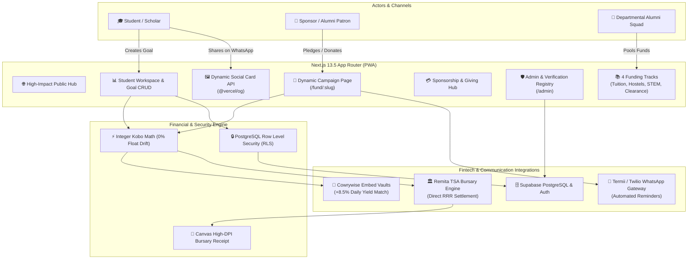

# EduFund 🎓
> **Every semester funded, before the deadline.**  
> *Direct Remita Bursary Settlement · Cowrywise Locked Vaults (+8.5% Yield Match) · Alumni Squads · Micro-Pledge Circles*

Built with conviction for the **Cowrywise Ambassadors Innovation Challenge 2026**.

---

## 🌟 Executive Summary

In Nigeria, over **300,000 university undergraduates** risk examination disqualification or academic deregistration each session not because they lack sponsors, but due to **timing mismatches, fragmented pledge collection, and lack of trust in student personal accounts**.

**EduFund** eliminates this tuition deficit by combining:
1. **Cowrywise Locked Savings Vaults** that earn daily high-yield returns (+8.5% p.a.) while students and sponsors save towards academic deadlines.
2. **Direct Remita Central Bank / TSA Settlement** ensuring funds are disbursed directly to verified university bursary accounts via Remita Retrieval Reference (RRR) codes — **zero funds are diverted to personal accounts**.
3. **Alumni & Departmental Class Squads** allowing graduating classes (e.g., *UNILAG Computer Science '18*, *UI Clinical Medicine '20*) to pool funds for multiple indigent scholars in their faculty.
4. **WhatsApp-First Campaign Viral Loop** with automated micro-pledge reminders (Termii/Twilio) and dynamic OpenGraph social preview cards (`@vercel/og`).
5. **High-DPI Official Bursary Tax & Clearance Receipts** generated on-device for physical presentation at faculty clearance desks.

---

## 🏗️ System Architecture



---

## 🚀 Key Innovations & Features

### 1. 💼 Cowrywise Locked Vaults with Yield Match
- Funds earmarked for school fees are locked into interest-yielding Cowrywise Vaults.
- Students and patrons earn **+8.5% p.a. yield match** while counting down to matriculation and registration deadlines.
- Protected against emotional withdrawals or inflation before payment clearance.

### 2. 🏛️ Direct Remita TSA Bursary Settlement
- Solves the sponsor trust gap: sponsors do not transfer money to a student's personal bank account.
- Contributions are disbursed directly to the **Federal Republic of Nigeria Treasury Single Account (TSA)** or state university bursaries via official **Remita Retrieval Reference (RRR)** codes.
- Generates **300 DPI High-Resolution Bursary Receipts** that students can download and print for immediate faculty clearance.

### 3. 👥 Alumni & Class Group Challenges ("Squads")
- Class sets (e.g. *UNILAG Law '16*, *UNN Electrical Engineering '20*) create collective departmental squads.
- Squad coordinators track cumulative targets, backed scholars, and live contribution progress.
- Public directory at `/squads` and deep individual campaign hubs at `/squads/[id]`.

### 4. 💬 WhatsApp-First Viral Sharing & Automated Reminders
- One-click campaign distribution with pre-formatted WhatsApp templates formatted for Nigerian social circles.
- Automated reminder engine (`/api/whatsapp/remind`) powered by Termii/Twilio WhatsApp API to reduce pledge drop-offs.
- Integrated Web Share API with fallback clipboard copy.

### 5. 🖼️ Dynamic Social Preview Cards (OG Image Generation)
- Next.js Edge runtime `@vercel/og` (`/api/og`) generates real-time branded progress preview cards when a student link (`/fund/unilag-tuition-2026`) is shared on WhatsApp, Twitter/X, or LinkedIn.
- Live rendering of target amount (₦), confirmed savings, percentage funded bar, and days left.

### 6. 📱 Responsive Hybrid Workspace Layout
- **Desktop**: Fixed left navigation sidebar with student identity badge, live workspace metrics, and verified status.
- **Mobile**: Fixed bottom dock navigation bar (`DashboardBottomNav`) with floating quick-action goal launcher and slide-out navigation sheet.
- **Theme Engine**: Seamless light and dark mode with high-contrast bursary receipt styling.

---

## 🔒 Financial Integrity & Security

| Security Layer | Implementation |
| :--- | :--- |
| **Integer Kobo Precision** | All monetary amounts are calculated strictly in integer kobo (`₦1 = 100 kobo`). Zero JavaScript floating-point rounding errors. |
| **Row Level Security (RLS)** | Scoped PostgreSQL RLS policies across all tables. Users only update their own goals and profiles; public visitors can only read published campaigns. |
| **Zero Service-Key Exposure** | Browser client only utilizes `NEXT_PUBLIC_SUPABASE_ANON_KEY`. Administrative updates and service role operations are isolated to server-side Edge functions. |
| **Input Validation** | Strict Zod validation and integer sanitization on goal targets, pledge intervals, and student registration forms. |
| **HTTP Security Headers** | Hardened `next.config.js` including `Strict-Transport-Security`, `X-Frame-Options: SAMEORIGIN`, `X-Content-Type-Options: nosniff`, and restricted `Permissions-Policy`. |

---

## 📊 Database Schema (Supabase PostgreSQL)

| Table | Purpose | RLS Policy |
| :--- | :--- | :--- |
| `profiles` | Student and sponsor user profiles (extends `auth.users`) | Authenticated own SELECT/UPDATE; Public display name read |
| `education_goals` | University tuition & accommodation funding campaigns | Owner CRUD; Public read published campaigns |
| `contributions` | Real-time and verified bursary contributions | Insert public; Owner view |
| `pledges` | Recurring sponsor commitments (daily/weekly/monthly) | Public insert; Sponsor delete before claim; Owner view |
| `encouragement_notes` | Verified donor encouragement messages | Public create; Admin moderation |
| `alumni_squads` | Departmental and class set pooled funding squads | Public read; Admin & coordinator manage |
| `provider_accounts` | Cowrywise vault account linkages | Server-role only |
| `provider_savings_plans`| Cowrywise locked savings plans and yield tracking | Server-role only |
| `provider_webhook_events`| Webhook idempotency and signature logging | Server-role only |

---

## 🛠️ Tech Stack

- **Framework**: Next.js 13.5 (App Router with Edge Runtime)
- **Language**: TypeScript 5 (Strict type checking)
- **Styling**: Tailwind CSS, PostCSS, Radix UI Primitives, Lucide Icons
- **Database & Auth**: Supabase (PostgreSQL 15, Supabase Auth, Row Level Security)
- **Social Cards**: `@vercel/og` (`ImageResponse` on Edge Runtime)
- **Receipts**: HTML5 High-DPI Canvas (`lib/receipt-download.ts`)
- **Animation**: Framer Motion & GSAP 3D perspective transforms

---

## 🏁 Quick Start & Local Setup

### Prerequisites
- Node.js 18.x or 20.x
- npm or pnpm

### Installation

```bash
# 1. Clone repository
git clone https://github.com/edufund/edufund.git
cd edufund

# 2. Install dependencies
npm install

# 3. Configure environment variables
cp .env.example .env.local

# 4. Run database migrations (or connect to pre-configured Supabase project)
# Migrations are located in supabase/migrations/

# 5. Start development server
npm run dev
```

Visit `http://localhost:3000` to view the platform.

---

## 🧪 Judge & Evaluator Demo Script

### 1. Test Admin Account
To test the **Admin & Verification Registry** (`/admin`):
- **Email:** `adeolalasisi6@gmail.com`
- **Password:** Log in via `/auth?mode=signin`
- *The account is whitelisted with full administrator status: approve/hide donor notes, review Remita RRR settlement logs, and create Alumni Squads.*

### 2. End-to-End User Flow
1. **Explore Campaigns**: Visit `/explore` or `/tracks/tuition` to view live student targets across UNILAG, UI, OAU, FUTO.
2. **Dynamic Social Card**: Open `http://localhost:3000/api/og?title=UNILAG+Tuition+2026&name=Tunde+Bakare&target=%E2%82%A6450,000&raised=%E2%82%A6280,000&percent=62%25` to see the real-time social card.
3. **Pledge & WhatsApp Flow**: Visit any student campaign (e.g. `/fund/unilag-tuition-2026`), click **Pledge**, choose an interval, and test **One-Click WhatsApp Share**.
4. **Alumni Squads**: Visit `/squads` to view class sets pooling funds for multiple scholars, or create a new squad from `/admin`.
5. **Download Official Receipt**: Go to `/sponsor`, view your backed scholars, and click **Download Receipt** to generate a 300 DPI Remita bursary voucher.

---

## 🏆 Innovation Challenge Alignment

| Judging Criterion | EduFund Execution |
| :--- | :--- |
| **Financial Inclusion & Impact** | Direct solution to the Nigerian tertiary education financing gap; bridges indigent students with alumni networks and transparent locked savings. |
| **Cowrywise Ecosystem Value** | Leverages Cowrywise's core locked savings and daily yield match engine (+8.5% p.a.), transforming short-term tuition anxiety into disciplined wealth building. |
| **Technical Excellence** | Zero-drift integer kobo math, responsive dual desktop/mobile UX, automated WhatsApp integrations, Edge OG rendering, and strict RLS security. |
| **Product Completeness** | 21 production-ready routes, complete CRUD operations, official downloadable bursary tax receipts, and dedicated administrative oversight. |

---

## 📄 License & Attribution

Built for the **Cowrywise Ambassadors Innovation Challenge 2026**.  
Developed by the EduFund Engineering Team.
